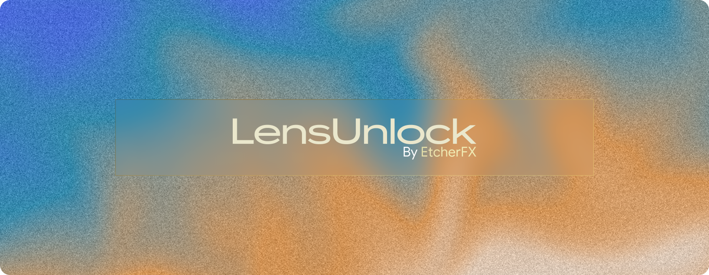

<h1 align="center">
  
</h1>

**An Xposed module that lets apps use the ultrawide lens, video stabilization and a steady frame rate.**

[What it does](#what-it-does) · [Why per app](#why-per-app) · [Status](#status)

> [!NOTE]
> LensUnlock is in development. There is no release yet and nothing to install.

## What it does

Many camera apps never ask for the ultrawide lens, video stabilization or a fixed frame rate, even though the device supports them. LensUnlock is a modern-API Xposed module (libxposed API 101, compiled against 102) that sets those capture-request values for Camera2 apps you pick. Each setting is opt-in per app, and when it's on it replaces whatever the app sent.

| Setting | Example | Effect |
|---|---|---|
| Zoom ratio | The logical back camera's minimum, `0.508` on a Pixel 10 Pro | Uses the ultrawide lens |
| Video stabilization | `PREVIEW_STABILIZATION` | Stabilizes the preview and the stream |
| AE target fps range | `[30,30]` (optional) | Holds a steady frame rate |

Settings are per app. The first tested target is Discord (`com.discord`), whose stock `org.webrtc` `Camera2Session` captures at 1280x720 with zoom `1.0`, video stabilization off and an AE fps range of `[15,30]`.

## Why per app

Capture requests are built inside the app, so the module is scoped to the apps you pick and runs in their processes. `cameraserver` is native code that Xposed can't hook, and `system_server` sees the requests too late, so neither is the right layer.

## Status

Planned work is the hooks and a settings screen for choosing apps and their values. Tested frameworks will be listed here once there is something to test; the sibling project [CameraRefreshFix](https://github.com/etcherfx/CameraRefreshFix) uses Vector 2.2 (the JingMatrix LSPosed fork).

## Development

Everything Android-related builds inside a Docker container; see [CONTRIBUTING.md](CONTRIBUTING.md) for the commands and [AGENTS.md](AGENTS.md) for the code map.

## License

[GPL-3.0](LICENSE)
